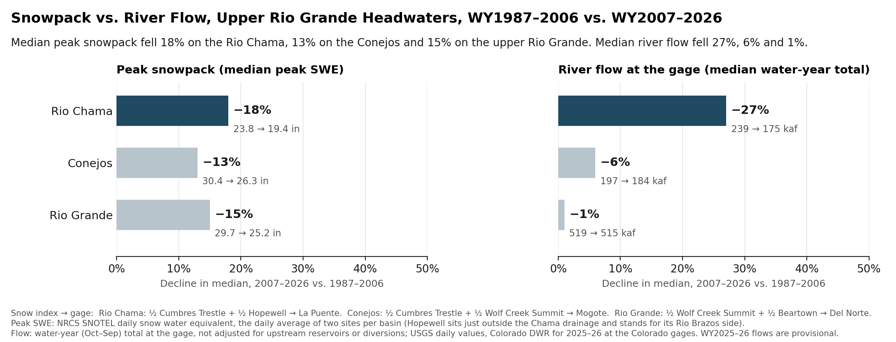
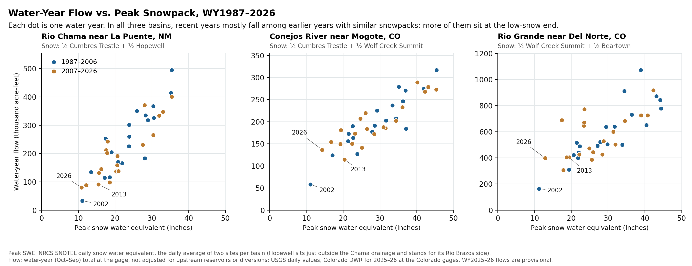
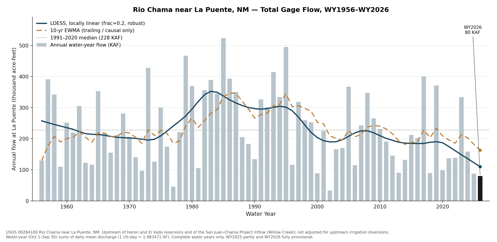

Most of the water in the upper Rio Grande starts as mountain snow. This page compares the peak snowpack at high-elevation SNOTEL sites with the water that passed the first river gage below each headwater basin, for water years 1987 through 2026 (each runs October through September). Data run through September 30, 2026.

| Basin | Snowpack (NRCS SNOTEL, average of two sites) | River gage |
|---|---|---|
| Rio Chama | Cumbres Trestle and Hopewell | Rio Chama near La Puente, NM |
| Conejos River | Cumbres Trestle and Wolf Creek Summit | Conejos River near Mogote, CO |
| Upper Rio Grande | Wolf Creek Summit and Beartown | Rio Grande near Del Norte, CO |

A snow site measures one point high on a mountain. A stream gage measures everything that flows past it from the whole basin above. Snow sites sit where snow is deep and lasts, and much of each basin sits lower and holds less snow per acre, so their readings work as an index of how snowy a year was, not a measure of how much water the whole snowpack holds. Pairing two snow sites per basin is a judgment about which points best stand for that basin. For the Rio Chama, I average Cumbres Trestle (the upper Chama) with Hopewell in the Tusas Mountains, which stands in for the Rio Brazos side. The two halves each supply roughly half of the river's summer flow at La Puente. I've used this pairing for years from time spent in these mountains, and the gage data back it up.

## The Chama lost the most snow, and the most water

::: {.column-page}
{fig-alt="Bar charts comparing 1987–2006 with 2007–2026. Median peak snowpack fell 18% on the Rio Chama, 13% on the Conejos and 15% on the upper Rio Grande. Median water-year flow fell 27%, 6% and 1%."}
:::

Comparing the first 20 years of the shared record (1987–2006) with the last 20 (2007–2026), median peak snowpack fell 18% on the Rio Chama, 13% on the Conejos and 15% on the upper Rio Grande. Median water-year flow fell 27%, 6% and 1%.

The Chama's flow has always swung harder than its snow: in 1987–2006, each 1% change in its snowpack came with about a 1.5% change in flow, because soils, plants and evaporation take their share of the melt first. The Conejos and the upper Rio Grande tracked their snow about one for one. Measured against how each river responded to its snowpack in 1987–2006, all three delivered about what their snow predicted in 2007–2026. The Rio Chama came in 5% under that expectation, the Conejos even with it and the upper Rio Grande 6% over, all within normal year-to-year variation.

## Flow still follows snow

::: {.column-page}
{fig-alt="Three scatter plots of water-year flow against peak snow water equivalent, one dot per year, colored 1987–2006 and 2007–2026. In all three basins the recent years mostly overlap earlier years with similar snowpacks. 2002, 2013 and 2026 are labeled."}
:::

Each dot is one water year. In all three basins, recent years mostly fall among earlier years with similar snowpacks. More of them sit at the low-snow end.

## Seventy years at La Puente

::: {.column-page}
{fig-alt="Bar chart of Rio Chama water-year flow at La Puente, 1956–2026, with a LOESS trend line, a 10-year moving average and the 1991–2020 median of 228 thousand acre-feet. Water year 2026 is highlighted at 80 thousand acre-feet."}
:::

The La Puente gage has measured the Rio Chama since 1955. It sits upstream of El Vado Reservoir and of the point where San Juan–Chama Project water enters the river, so its flows contain no imported water. Water year 2026 (provisional) brought 80 thousand acre-feet, about 35% of the 1991–2020 median of 228.

## What this shows, and what it doesn't

All three headwater rivers carried less water after 2006, about as much less as their smaller snowpacks predict, and the Rio Chama lost the most of both. None of the three is delivering clearly less than its snowpack predicts.

Things to keep in mind:

- **The Chama's snow index matters.** With Cumbres Trestle alone, the Chama looks like it now makes less water per inch of snow: 13% less than Cumbres predicts, with a statistically significant downward trend. With both halves of the basin represented, it doesn't. Any blend that gives the Hopewell side at least 30% of the weight shows no significant shortfall.
- **On the Conejos and the upper Rio Grande, flow fell less than snow** (6% vs. 13%, and 1% vs. 15%), even though both rivers have historically tracked their snow about one for one. That's within normal variation. It could mean these basins kept more of their snow than the high sites near the Continental Divide show, or that rain, groundwater and reservoir releases made up part of the difference. These data can't tell which.
- **Snow sites are points near 10,000 feet.** They can't see snow at middle elevations, and in dry summers the middle of the Chama basin adds little or nothing to the river at La Puente.
- **The flow numbers don't depend on any of these choices.** Wherever the record is split, from 1997 to 2016, the Chama's median flow fell 27–46%, while the other two rivers' fell at most 23%.

::: {.callout-note collapse="true"}
## Methods and data

**Snow.** NRCS SNOTEL daily snow water equivalent at Cumbres Trestle (431:CO:SNTL), Hopewell (532:NM:SNTL), Wolf Creek Summit (874:CO:SNTL) and Beartown (327:CO:SNTL). Each basin's index averages two sites' daily values (both must report), then takes the year's peak. A year needs at least 250 days of snow data before July 1.

**The Chama's snow index.** Hopewell sits just outside the Chama drainage and stands in for the Rio Brazos side of the basin. Seasonal gages on the upper Chama (above Chama) and the Rio Brazos (at Fishtail Road), running since 2014, show each supplying roughly a third to a half of La Puente's May–September flow. In years when Hopewell is snowier relative to Cumbres, the Brazos carries a larger share (rank correlation 0.77 over 10 summers). Over 1987–2026, the Cumbres–Hopewell average explains 80% of the year-to-year variation in La Puente's flow; Cumbres alone explains 73%. Giving Cumbres anywhere from 0% to 70% of the weight shows no significant shortfall; 80% or more does.

**Flow.** USGS daily mean discharge at Rio Chama near La Puente (08284100), Conejos River near Mogote (08246500) and Rio Grande near Del Norte (08220000). USGS daily values for the two Colorado gages end in December 2024; from January 2025 this page uses the Colorado Division of Water Resources' reviewed record (CONMOGCO, RIODELCO). Water-year flow is the sum of daily mean flow times 1.983471 acre-feet per cfs-day, for years with at least 360 days of record. Flows are as measured at the gage, not adjusted for upstream reservoirs or diversions.

**Expected flow.** Each river's water-year flow is fit against its snow index for 1987–2006 (a straight-line fit) and applied to each 2007–2026 snowpack. "Within normal year-to-year variation" means inside the range where the 20-year average would fall 90% of the time if the 1987–2006 relationship still held.

**Periods.** Water years 1987–2006 and 2007–2026: equal 20-year halves of the record all three basins share. Wolf Creek Summit's first full season is 1987.

**La Puente chart.** LOESS: locally linear, frac = 0.2, robust. Moving average: 10-year exponentially weighted, trailing only. Median: 1991–2020.

**Limits.** Water years 2025 and 2026 are provisional. Flows at Mogote and Del Norte are affected by upstream reservoirs (Platoro; Rio Grande Reservoir) and small transbasin imports. Two snow sites stand in for each basin, and Hopewell lies outside the drainage it represents.

**Data.** [Every water year (CSV)](data/headwaters/snow_to_flow_water_years.csv) · [Medians and changes (CSV)](data/headwaters/snow_to_flow_summary.csv) · [La Puente annual flow, 1956–2026 (CSV)](data/headwaters/la_puente_wy_flow_1956_2026.csv)
:::
